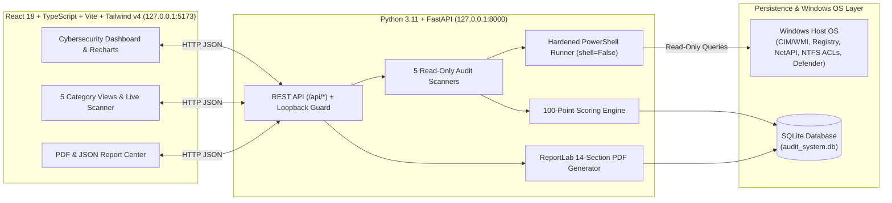

# WinSecAudit — Windows Security Auditing & Compliance System

**University Cybersecurity Project: Security Audit of a Computer System**

**WinSecAudit** is a full-stack, read-only Windows host security posture auditing system that inspects a Windows computer across five core cybersecurity domains, evaluates 31 security checks using a transparent 100-point scoring model, stores historical scan telemetry in SQLite, and generates formal 14-section PDF and JSON Security Audit Reports.

---

## 🌐 Three-Page Project Portfolio Website (GitHub Pages)

This repository includes a complete **Three-Page Portfolio Website** inside the [`docs/`](./docs/) folder, configured for immediate deployment on **GitHub Pages**:

1. **Page 1 — 01 · Project Overview:** [`docs/index.html`](./docs/index.html)
2. **Page 2 — 02 · Methodology & Tools:** [`docs/methodology.html`](./docs/methodology.html)
3. **Page 3 — 03 · Findings & Recommendations:** [`docs/findings.html`](./docs/findings.html)
4. **Downloadable Portfolio Deliverables:**
   - [Sample 14-Section PDF Security Audit Report (`docs/assets/DEMO_SAMPLE_WinSecAudit_Report.pdf`)](./docs/assets/DEMO_SAMPLE_WinSecAudit_Report.pdf)
   - [Sample Structured JSON Audit Dataset (`docs/assets/DEMO_SAMPLE_WinSecAudit_Report.json`)](./docs/assets/DEMO_SAMPLE_WinSecAudit_Report.json)
   - [Written Academic Project Report (`PROJECT_REPORT.md`)](./PROJECT_REPORT.md)

---

## 1. Key Features & Audited Security Domains

WinSecAudit performs real, non-destructive inspections on the host Windows operating system across five modules:

| Module | Category | Max Weight | Key Security Checks & Telemetry Inspected |
| :--- | :--- | :---: | :--- |
| **Module A** | **Cybersecurity Dashboard** | — | Overall 100-point radial gauge, Recharts category breakdown & status donut charts, priority actionable findings, hardware/OS profile, and recent scan history. |
| **Module B** | **User Account Audit** | **20 pts** | Local user accounts (`Get-LocalUser`), `Administrators` group membership, built-in `Guest` (RID 501) and `Administrator` (RID 500) status, `PasswordRequired=False` vulnerability detection, non-expiring passwords, and `net accounts` password length & lockout policies (`USR-001` – `USR-007`). |
| **Module C** | **System Update Audit** | **20 pts** | Windows OS version and build servicing currency, installed KB hotfixes (`Get-HotFix`), days elapsed since last security patch, `wuauserv` & `UsoSvc` service status, Automatic Update registry policies, and cached pending updates (`UPD-001` – `UPD-005`). |
| **Module D** | **File & Permission Audit** | **20 pts** | NTFS Access Control List (`Get-Acl`) inspection on `C:\Windows\System32`, `C:\Windows\System32\drivers\etc\hosts`, `C:\Program Files`, machine-wide `StartUp` folder, `C:\Users\Public`, and `C:\Windows\Temp` for overly permissive `Everyone` or non-admin write/FullControl rights (`PERM-001` – `PERM-005`). |
| **Module E** | **Running Services Audit** | **15 pts** | Enumeration of all Windows services (`Win32_Service`), `CWE-428` Unquoted Service Binary Path vulnerability detection, `RemoteRegistry` status, legacy cleartext services (`TlntSvr`, `FTPSVC`, `SNMP`, `SimpTcp`), `Print Spooler` exposure, and third-party `LocalSystem` services (`SVC-001` – `SVC-005`). |
| **Module F** | **Security Configuration Audit** | **25 pts** | Windows Defender Antivirus & Real-Time Protection (`Get-MpComputerStatus`), Security Intelligence signature age, Tamper Protection, Windows Firewall (`Domain`, `Private`, `Public`), UAC Secure Desktop, Remote Desktop (RDP & NLA), UEFI Secure Boot, BitLocker status, and SMBv1 deprecation (`SEC-001` – `SEC-009`). |

---

## 2. System Architecture



### Security & Read-Only Guarantees
- **Zero Password Exposure:** Never queries, extracts, or stores user passwords or NTLM hashes.
- **No Arbitrary Command Execution:** Frontend requests never supply shell arguments; all PowerShell script blocks are predefined on the backend and executed with `subprocess.run(..., shell=False)`.
- **Forbidden Verb Guard:** `backend/app/core/powershell.py` enforces a static blocklist preventing any state-changing cmdlets (`Stop-Service`, `Set-Service`, `Remove-Item`, `Set-Acl`, `Disable-LocalUser`, `Set-NetFirewallProfile`, `Set-MpPreference`, `Install-WindowsUpdate`, `Invoke-Expression`, etc.).
- **Localhost Loopback Isolation:** FastAPI middleware rejects requests from non-loopback IP addresses (`HTTP 403`).
- **Graceful Privilege Handling:** Clearly distinguishes between disabled protections (`FAIL`) and telemetry that requires Administrator elevation (`NOT_ASSESSED`), excluding `NOT_ASSESSED` checks from the scoring denominator.

---

## 3. Project Folder Structure

```text
Audit System/
├── backend/
│   ├── app/
│   │   ├── api/routes.py               # REST API endpoints (/api/*)
│   │   ├── auditors/                   # The 5 Windows Security Audit Scanners
│   │   │   ├── base.py
│   │   │   ├── users_auditor.py        # Module B: Local Users & Password Policy
│   │   │   ├── updates_auditor.py      # Module C: Windows Updates & Hotfixes
│   │   │   ├── permissions_auditor.py  # Module D: NTFS File & Folder ACLs
│   │   │   ├── services_auditor.py     # Module E: Running Services & CWE-428
│   │   │   └── security_auditor.py     # Module F: Defender, Firewall, UAC, BitLocker
│   │   ├── core/
│   │   │   ├── powershell.py           # Read-only PowerShell execution engine
│   │   │   ├── system_info.py          # Hardware, OS build, & privilege collector
│   │   │   ├── scoring.py              # 100-point weighted scoring engine
│   │   │   └── persistence.py          # SQLite CRUD service
│   │   ├── models/audit_models.py      # SQLAlchemy ORM models
│   │   ├── reports/
│   │   │   ├── pdf_generator.py        # 14-section ReportLab PDF builder
│   │   │   └── json_exporter.py        # Structured JSON report exporter
│   │   ├── schemas/audit_schemas.py    # Pydantic v2 validation schemas
│   │   ├── config.py
│   │   ├── database.py
│   │   └── main.py                     # FastAPI entry point
│   ├── tests/                          # Automated pytest suites (19 tests)
│   ├── pytest.ini
│   └── requirements.txt
├── frontend/
│   ├── src/
│   │   ├── api/client.ts               # Typed REST API client
│   │   ├── components/                 # Badges, FindingCard, Sidebar, Header
│   │   ├── context/AuditContext.tsx    # Global state provider
│   │   ├── pages/                      # All 10 Cybersecurity UI Views
│   │   ├── types/audit.ts              # TypeScript interfaces
│   │   ├── App.tsx
│   │   └── main.tsx
│   ├── package.json
│   └── vite.config.ts
├── samples/                            # Sanitized Demo Reports for GitHub
│   ├── DEMO_SAMPLE_WinSecAudit_Report.pdf
│   └── DEMO_SAMPLE_WinSecAudit_Report.json
├── start_audit_system.bat              # One-click Windows launcher
├── .gitignore
└── README.md
```

---

## 4. Installation & Running the Application

### Prerequisites
- **OS:** Windows 10 or Windows 11 (with Windows PowerShell 5.1)
- **Python:** Python 3.11+
- **Node.js:** Node.js 18+ / 20+ / 24+

### Quick Start (One-Click Launcher)
Double-click **`start_audit_system.bat`** in the root directory, or run from PowerShell:
```powershell
.\start_audit_system.bat
```

### Manual Setup & Execution

#### 1. Backend Setup (FastAPI)
```powershell
cd backend
python -m venv .venv
.\.venv\Scripts\pip.exe install -r requirements.txt
.\.venv\Scripts\uvicorn.exe app.main:app --host 127.0.0.1 --port 8000 --reload
```
- **API Base URL:** `http://127.0.0.1:8000`
- **Interactive Swagger UI Docs:** `http://127.0.0.1:8000/api/docs`

#### 2. Frontend Setup (React + TypeScript + Vite)
```powershell
cd frontend
npm.cmd install
npm.cmd run dev
```
- **Dashboard URL:** `http://127.0.0.1:5173`

> **Tip for Administrator Checks (BitLocker):** To allow `SEC-008` (`Get-BitLockerVolume`) to assess full-disk encryption, launch the backend terminal as **Administrator**. When run as a Standard User, `SEC-008` is safely marked `NOT_ASSESSED`.

---

## 5. REST API Documentation

| Method | Endpoint | Description |
| :---: | :--- | :--- |
| `GET` | `/api/health` | Operational health check and version status |
| `GET` | `/api/system/info` | Collects host hardware, OS build, user, and privilege context |
| `POST` | `/api/audit/start` | Runs all 5 audit modules, computes score, persists to SQLite |
| `GET` | `/api/audit/status/{audit_id}` | Returns execution status and summary counters for an `audit_id` |
| `GET` | `/api/audit/results/latest` | Returns the full results of the most recent audit session |
| `GET` | `/api/audit/results/{audit_id}` | Returns the full results for a specific `audit_id` |
| `GET` | `/api/audit/users` | Returns Module B (User Account Audit) findings and accounts |
| `GET` | `/api/audit/updates` | Returns Module C (System Update Audit) findings and hotfixes |
| `GET` | `/api/audit/permissions` | Returns Module D (File Permission Audit) findings and ACEs |
| `GET` | `/api/audit/services` | Returns Module E (Running Services Audit) findings and services |
| `GET` | `/api/audit/security` | Returns Module F (Security Configuration Audit) controls |
| `GET` | `/api/history` | Lists historical audit sessions stored in SQLite |
| `GET` | `/api/reports` | Lists generated PDF and JSON report deliverables |
| `POST` | `/api/reports/{audit_id}/generate?format=pdf` | Generates a 14-section PDF (`pdf`) or JSON (`json`) report |
| `GET` | `/api/reports/{report_id}/download` | Downloads the generated report file |

---

## 6. Running the Automated Test Suite

WinSecAudit includes **19 automated tests** verifying every scanner module, the 100-point scoring engine, SQLite persistence, PDF/JSON report generation, API validation, and read-only PowerShell guards:

```powershell
cd backend
.\.venv\Scripts\pytest.exe -v
```

---

## 7. Sample Demonstration Deliverables

Sanitized demonstration reports (labelled `LAB-DEMO-PC01 (DEMO SAMPLE DATA)`) are included in the [`samples/`](./samples/) directory for academic review:
- [`samples/DEMO_SAMPLE_WinSecAudit_Report.pdf`](./samples/DEMO_SAMPLE_WinSecAudit_Report.pdf)
- [`samples/DEMO_SAMPLE_WinSecAudit_Report.json`](./samples/DEMO_SAMPLE_WinSecAudit_Report.json)

*(Personal host scan databases and personal PDF reports in `backend/generated_reports/` are excluded via `.gitignore`.)*
